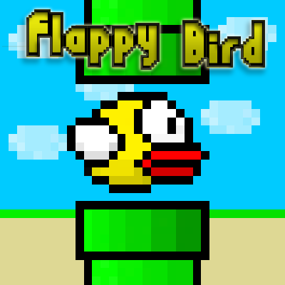

# Potter's games

<nav class="navbar">
  <ul>
      <li><a href="https://potter414.github.io/" class="active">Home</a></li>
      <li><a href="downloads.html" class="active">Downloads</a></li>
      <li><a class="active">Favorited Games</a></li>
      <li><a class="active">Popular Games</a></li>
      <li><a class="active">Instructions</a></li>
  </ul>
</nav>

Welcome to the downloads page where you can click on any link to download the game!

<a href="https://github.com/potter414/potter414.github.io/raw/refs/heads/main/better_flappy_bird_pygame/flappy_bird.zip" target="_blank" download>Download Folder
  
</a>
<!--<a href="https://github.com/potter414/potter414.github.io/raw/refs/heads/main/better_flappy_bird_pygame/dist" target="_blank" download> Click here to download flappy bird! --> 
